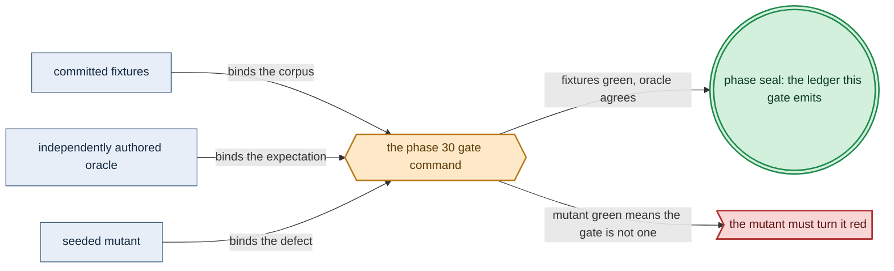
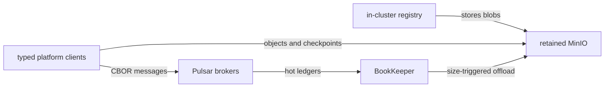

# Phase 30: Platform backbone (MetalLB + MinIO + Pulsar HA)

> **Purpose**: Stand up the platform backbone — MetalLB, MinIO, and Pulsar HA
> (brokers/ZooKeeper/BookKeeper/offload) — on a
> single-node linux-cpu cluster, each as its HA topology from Haskell-generated manifests and baked-binary
> images, rehoming the `distribution` registry's blob store onto the MinIO S3 driver and proving a
> size-triggered Pulsar offload bounds the hot tier.
> **Read this if**: phase 30 is next in the queue, or a later phase depends on what its gate establishes.

Phase 30 delivers the platform backbone (MetalLB + MinIO + Pulsar HA); its design is owned by [platform_services_doctrine.md](../documents/engineering/platform_services_doctrine.md), [pulsar_client_doctrine.md](../documents/engineering/pulsar_client_doctrine.md), [image_build_doctrine.md](../documents/engineering/image_build_doctrine.md), and the plan for reaching it is owned here.
Register 3, live, on the `linux-cpu` substrate.
The complete gate passed on 2026-08-10.

> **Historical result (invalidated).** Any pass, seal, validation, ledger, receipt, or implementation observation
> in the orientation text above is diagnostic only. The Phase Status section and [tracker](README.md) own current state; the
> target contract below remains normative.

Link-graph metadata

**Status**: Authoritative source
**Supersedes**: N/A
**Referenced by**: DEVELOPMENT_PLAN/README.md, DEVELOPMENT_PLAN/legacy_tracking_for_deletion.md, DEVELOPMENT_PLAN/overview.md, DEVELOPMENT_PLAN/phase_08_storage_geometry_folds.md, DEVELOPMENT_PLAN/phase_25_base_image_registry.md, DEVELOPMENT_PLAN/phase_28_retained_storage.md, DEVELOPMENT_PLAN/phase_29_vault_pki.md, DEVELOPMENT_PLAN/phase_31_platform_services_2.md, DEVELOPMENT_PLAN/phase_33_live_dsl_singleton.md, DEVELOPMENT_PLAN/phase_35_pulsar_client.md, DEVELOPMENT_PLAN/phase_48_determinism_jitcache.md, DEVELOPMENT_PLAN/system_components.md, documents/engineering/migration_doctrine.md, documents/engineering/platform_services_doctrine.md, documents/engineering/resource_capacity_doctrine.md
**Generated sections**: none

## Contents
- [Phase Status](#phase-status)
- [Phase Summary](#phase-summary)
- [Gate integrity](#gate-integrity)
- [Doctrine adopted](#doctrine-adopted)
- [Sprints](#sprints)
- [Sprint 30.1: MetalLB LoadBalancer + MinIO object substrate + registry S3-driver rehoming 🔄](#sprint-301-metallb-loadbalancer--minio-object-substrate--registry-s3-driver-rehoming-)
- [Sprint 30.2: Pulsar native-protocol backbone + size-triggered S3 offload drill ⏸️](#sprint-302-pulsar-native-protocol-backbone--size-triggered-s3-offload-drill-)
- [Sprint 30.3: The backbone HA bring-up gate ⏸️](#sprint-303-the-backbone-ha-bring-up-gate-)
- [Documentation Requirements](#documentation-requirements)
- [Related Documents](#related-documents)

---

## Phase Status

🔄 Active — resumed 2026-11-03 after Phase29 resealed as
`sha256:aa8cd69d910d376b74852e30608db5df3115d9bbba044c1bf31900824bdc53be`.
Phases25–29 are sealed in numerical order. Phase31 stays blocked until the complete amended Phase30 gate
passes. Earlier2026-08-10 completion claims were invalidated by artifact-hygiene and coverage gaps.
No sprint closure or Phase30 seal is claimed.

**2026-11-04 — durable metadata reservation:** the separate store passes32API/lock/alias cases, ten
exception/process-exit checks, twelve malformed wires and four literal encodings. It requires exclusive fresh
initialization and matching restart policy, and poisons its handle after an uncertain persistence error.
Independent review and syscall tracing verify file/parent/directory sync and lifetime locking. All62backbone
host checks pass. The private additive3MiB witness passes22storage boundaries and nine schema bounds.
A coordinated parent understatement goes red before repair and passes afterward. Native StoragePlan now retains
the complete privately derived parent/budget witness; independent real-handoff comparison and14reader
corruptions pass at8MiB usable with unchanged64MiB raw and parent total. Sampled whole-filesystem growth is observed
from an empty pre-writer baseline, including unlinked/control allocation. Independent integration review passes. The first8MiB diagnostic passes transfer and all three initial
snapshots, then rejects the REST owner hostname because its reader expected a different service suffix.
The reader now requires the actual rendered broker-headless name; both owners, body-preserving redirects
and ten hostile redirects pass. Cleanup succeeds. The next8MiB run passes readiness and the250sample positive at61,965bytes against
65,536, with the245sample time-only control reaching413,100. It stops at restart-debt validation because
the gateway strips digits from the backend hash-mismatch code. The repaired bounded alphanumeric filter
passes ten native code/fallback cases and the complete focused native suite; a fresh run is started. Raw
census/file consistency is rechecked separately without independent device, current-state or complete-history
credit. The preceding5MiB
run exposed TCP readiness before snapshot.0. A bounded180-second pre-client wait preserves the742-byte
parse/provenance contract; five startup checks and ten independent deadline/before/after cases pass.

**2026-11-03 — current validation:** all33 independent Distribution DeleteObjects cases and the focused
native suite pass. The exact packaged AWS SDK emits Quiet before or after its Object group; the parser now
accepts either order once, preserving16keys/512key bytes/65,536body bytes and complete-document validation.
Every extracted key is checked before one backend delete. The next fresh diagnostic adds a mixed
owned/foreign bulk request, precise scope denial and independent own-object preservation/foreign absence.
The preceding replacement run passes physical fit, Vault, application boundaries and all84 canonical
transfers, then rejects this source-supported XML ordering. Cleanup completes without failures. An earlier
host reboot interrupted preallocation; its exact marker-owned abandoned root was removed after verifying
that no owned runner or mounts remained. The next diagnostic passes the complete registry transfer and post-cutover upload, then stops at66,096
positive hot bytes against the unchanged65,536-byte cap after separate readiness completes. Its precreated
empty positive ledger has aged past the one-minute maximum rollover time; the first message closes a
one-entry ledger, and offloaded-but-present bytes remain charged. The census also rejects the source's
16-byte header beyond its16MiB preallocation quantum. The independently reviewed fixes select16380KiB preallocation and create the positive topic only after
readiness; first-write age must be observed below60seconds. All11padding cases and native rendering pass;
no maximum is raised. The next run passes the smaller preallocation and captures all three source-derived initial snapshots.
Its first-write guard correctly stops before publication after slow CLI setup consumes the freshness window.
Source-backed bounded REST create/lookup and earlier policy checks now remove that setup delay; the deadline,
stream, trigger and cap stay unchanged. The census also exposed nullable transaction digests: nine independent
records, two mixed logs, nine strict negatives and prefix replay now pass. All38backbone host tests pass.
Captured current log parsing succeeds, without complete-history credit. Cleanup completes without failures. The next diagnostic is prepared with these fixes; these runs supply no gate seal.

The metadata-member constructor now joins each actual expanded executor, ordinal/pod, reserved resource
vector, PVC/template, distinct backing and parent debit. All37 independent three/five-member cases pass,
including complete4/16 fault maps, exact identity rows, coordinated zero-pod rejection and shortages with compensating neighbor surplus. Every manifest stage
requires the private witness, which supplies ZooKeeper resources, raw claims and server ordinals. These
are policy/admission checks; five-member coverage is pure, and runtime adequacy/history remain separate.
The real handoff also passes the native CLI positive with exact identity rows,24per-member shortages
and one parent shortage. The fresh harness enacts these checks before any backbone API write; its next
accepted-source run still needs validation. The shared execution core now rejects emitted Kubernetes pods
with zero reserved pod slots while allowing host processes and empty controllers. The independent14-case
suite goes red before the repair and passes afterward, alongside focused accelerator, transition, reconciler
and backbone compatibility suites. This does not claim an earlier phase gate rerun.

The independent census now saves bounded raw parsed files, binds stable source identity/allocated extent
to the final trace sample, and recomputes final counters from those saved bytes. Full ZooKeeper snapshot
and transaction decoding replaces outer-checksum-only snapshot acceptance. Checksum-valid unparsed trees,
missing raw files, changed extents and forged counters reject. All38 backbone host tests pass. Individually
captured current files do not establish atomic state, discarded history or pre-run structural bounds.

**2026-11-03 — source/runtime binding:** private structured constructors retain the original model through
source admission, writer policy and merged peak. Runtime decoding reconstructs those private witnesses,
rederives Pulsar residents/populations and checks owner/budget/scope, complete domains, quotas and funded
whole-write/failure slots. Registry base/excess slices use one shared equal-count/equal-horizon grouping;
separate physical charges remain. Coalesced/fragmented funding, coordinated edits, omitted residents,
inconsistent horizons and one-unit quota shortages reject. The small canonical fixture admits the same
fresh64KiB write through both paths. Native tests and independent review pass.
Actual expanded registry/transfer, broker and gateway executors resolve to the same private writer policy;
missing/extra/duplicate/wrong-owner/budget/scope/kind cases reject before manifest rendering.

**2026-11-03 — offload diagnostics:** the unchanged100×4KiB streams run at two messages/second. After the
reviewed AWS chunk-signature translation, the positive has247samples and a61,965-byte maximum against the
65,536-byte cap; its time-only control has242samples and reaches413,100bytes. Flags remain size32,768,
age−1, deletion-lag0; the paired control uses size−1, age1h, lag0. Thirty independent signed-wire cases pass.
The gateway verifies original header/chunk/zero-chunk MACs, forwards decoded bytes under their actual hash,
preserves offloader user metadata and releases delete/abort reservations only after observed absence.
A real scoped JClouds upload retry has zero failed debt. A separate gateway/both-broker restart and ledger
unload recovers all100payloads from19 independently reclaimed ledger IDs through38 gateway object GETs;
startup preserves153reservations and zero debt. The loaded-topic observer retry passes without relaxing
its five-second HTTP bound or active sampling. Native CBOR dedup passes for7,7,8→2 deliveries.

The first cold SDK upload still exceeds the positive cap, so a separately bounded eleven-message automatic
offload/deletion readiness workload is explicit before the unchanged pair. It binds to the same broker and
policy and retains separate traces/costs. Fresh combined readiness, cold-read, restart/debt and census
validation remains open. No cap/threshold amendment is applied. Startup rejects unreserved backend
residents/uploads or excessive extents; this does not establish hidden physical failure history.

**2026-11-03 — storage and execution:** the native plan consumes the exact verified Phase25 handoff,
retaining41 digest objects/3,876,636,517stored bytes and the original5,371,532,322-byte registry peak,
then adds43 exact Distribution links. Diagnostics copy/read back all84objects, retain old source/route and
corrupt partial target on failed verification, change one Service selector after success, and recover a
fresh4KiB post-cutover blob from S3. Complete accepted-source field comparison remains required.
Sixteen filesystems, including Vault's two, MinIO/BookKeeper spares and gateway state, preallocate before
cluster creation. Parent raw demand is40,377,516,032bytes. Independent loop/file identity, allocation,
usable fit and eleven reader corruptions pass. Bookie raw minimum128MiB exposes106,266,624usable bytes;
the earlier64MiB/57,311,232usable profile correctly rejects56MiB demand. Five early composition tests pass.

The whole execution union is6,500m CPU/6,752MiB memory/3,072MiB ephemeral/eighteen pods; exact fit and all
four one-unit shortages pass. MinIO's two bounded requests use1,280MiB managed heap/1,536MiB ceiling;
broker NAR scratch is1,016MiB within1GiB ephemeral. Native copy/verification Jobs have finite concurrency,
zero retries and read-only sources. Complete Haskell rendering, eighteen earlier goldens and twelve renderer
mutants pass compatibility checks. All six earlier native Phase30 mutants are red at intended assertions,
with passing before/after baselines; final accepted-source mutant validation remains required.

**Independent capacity review:** the authorized single reviewer approves the registry mapping, application
populations, execution union, private source ownership, pinned offload model and placement/recovery/uniform
corpora. All six source arms have populations and paired quota denials. Raw Pulsar data/index bounds are
77,952/416bytes before positive1MiB quota rounding. The complete finite profile reserves128data/index pairs
plus concurrent/failed pairs. Recovery retains old backing, two survivors and a distinct new BookieId;
conditional epochs require old-controller retirement/process exit and grant no start permission.

ZooKeeper's pure3.9.3 model covers Jute/node/ACL/session/watch/snapshot/transaction/generation arithmetic,
including root aliases, Error/CheckVersion, container ownership and Multi identity resolution. Its independent
wire corpus has five snapshots,25records, four logs,19negatives and24replay steps; ten wire/capture host tests pass.
Checked replay refuses unsupported fuzzy/old/mismatched anchors. Node digests do not prove session state.
The source-derived real bootstrap validator now passes eight valid and25rejected wire cases, including
all six exact static-config orders and varying wallclock mtime. The new harness captures each fresh742-byte
initial snapshot before metadata clients, binds its stable filesystem identity, and preserves raw bytes;
the gate independently rechecks them. Fresh live capture, complete committed history and endpoint
provenance remain required; bootstrap validation supplies no current-state or lifetime-history proof.

The bookie profile remains conditional:4MiB all serialized history,4MiB incoming recovery and48MiB
journal/index/auxiliary allowance per admitted placement. ZooKeeper remains69MiB/member, with two normal
plus two incoming16MiB logs, three normal plus one incoming1MiB snapshots and1MiB other paths. Source
review shows metadata retries/session churn are not lifetime-bounded by operation timeout, batching flags,
roll thresholds or hourly purge. Actual producer/schema/history/file-generation enforcement, independent
complete-current evidence, final resource/readback binding and the fresh complete gate remain open.
The pure cumulative history-admission core is implemented in
`src/Amoebius/Platform/ZooKeeperHistory.hs`: immutable canonical transaction identities are separate from
physical attempts and retained generation debt. All40independently authored transition cases pass, including exact/one-byte limits, physical retry debt,
original-reservation requirements and restart round trips. The complete original policy is now retained privately by each state; eight cross-policy cases and21restart
cases pass after an independent pre-fix probe exposed unsafe quota relabeling. Checked immutable JVM capture passes689independent assertions against pinned Jute/Util. Per-attempt digest
rebinding from retained original bytes passes2547more, including mutation, exact limits and checked failures.
Fresh compilation records the complete class domain, including the byte-bound helper; the reader independently
hashes those classes and all337saved jars. The local weak-alias/strong-original registry passes2137independent assertions across four constructor,
32sequence and three concurrent cases, retaining debt after weak-alias collection. Native durable command
transport and a bounded Java client are implemented pending independent protocol tests and installation.
Actual coordinator/JVM interception remains uninstalled; no runtime history premise closes.
The gate explicitly rejects unresolved class derivations. Phases31 onward remain blocked.

## Phase Summary

This phase turns the storage-and-secrets-provisioned cluster of Phase 29 into an amoebius cluster carrying the
platform backbone: the L4 LoadBalancer (MetalLB), the MinIO S3 object substrate, and the Pulsar
native-protocol event/workflow backbone (brokers, ZooKeeper metadata members, BookKeeper bookies, and
size-triggered S3 offload). Each is rendered as
the byte-identical **HA topology even at `replicas=1`**, each emitted as typed Kubernetes objects by the
Phase-26 `renderAll` path (no Helm, no third-party charts, and the emitted manifests are generated from Haskell
and never committed), each served from binaries **baked into the multi-arch base image** with no
public-registry pull, and each on the Phase-28 `no-provisioner` retained PVs where it holds durable state.

Two deferred gaps from earlier phases close here. First, the **registry→MinIO S3-driver rehoming**: the
Phase-25 `distribution` registry ran against **interim node-local (filesystem-driver) blob storage** with the
MinIO S3 driver named as this phase's target; Phase 30 moves the registry's blob store onto MinIO via the S3
driver, so the registry holds no PV of its own and its bytes live in the object substrate. Second, the
**Pulsar size-triggered S3 offload**: a topic's hot tier (BookKeeper on retained PVs) is bounded by a size
high-water mark that offloads closed ledgers to MinIO, and this phase drills that the offload actually fires
under sustained ingest and that the hot tier never exceeds its cap.

The rehome is a verified migration, not a driver-only configuration edit, and it does not erase or replace the
registry's capacity proof. Phase 30 preserves the artifact/upload
operands from Phase 25's canonical `RegistryStorageDemand` — every digest-keyed compressed
layer/config/manifest extent, bounded model-derived concurrent-upload workspace, and finite failed-upload residue through
observed GC — while the replacement demand changes only its backend arm from the interim volume to MinIO. The resulting private
`ProvisionedRegistryStorageDemand` must carry the same logical `objectSet`, structured physical-object plus
upload/partial `objectStorePeak`, scalar interim `derivedPeak`, mutation-admission, and upload/orphan witness;
its backend projection is intentionally different. A private `ProvisionedRegistryBackendMigration` derives an
exact source-digest→target-object map, transfer/verification Job `PodResourceEnvelope`, workspace, and
source+target per-backing high-water. Only the structured target peak enters MinIO's per-object
erasure/healing geometry. Every pre-existing Phase-25 artifact is copied and independently digest-verified
before atomic driver cutover, then pulled by its old digest through the registry. Source filesystem residents
stay charged and readable until verification/cutover and remain charged with partial targets on failure; no
cleanup/reclamation is credited before it is observed. The target gets no speculative cross-backing dedup
credit.

The scope deliberately stops at *standing the backbone up HA and proving its data-plane round-trips, the
registry rehoming, and the offload bound*. The Percona-operator-managed per-consumer Patroni Postgres
clusters, pgAdmin, Prometheus/Grafana, and the **full derived readiness-DAG bring-up of the whole standard stack** are [Phase 31](phase_31_platform_services_2.md). The **Keycloak-owned ingress edge** — Envoy/Gateway
API terminating TLS and Keycloak owning all wild ingress so no workload publishes its own path — is
[Phase 32](phase_32_keycloak_ingress.md); this phase brings the backbone up behind no public edge. The
Deployment-`replicas=1` control-plane singleton that will eventually *own* this reconcile loop is
[Phase 33](phase_33_live_dsl_singleton.md); here the reconciler is driven from the operator/host path against a
fixed, hand-assembled service set so the backbone exists before the DSL and the singleton that will describe
it.

**Substrate:** linux-cpu ([§L](development_plan_standards.md#l-one-substrate-discipline)) — the whole gate runs on a single-node `kind` cluster on a linux-cpu host; no
specialized hardware feature is required. Every hardware substrate can always run this `linux-cpu` lane. If
the gate requires a pristine Linux host, use Incus on Linux or Linux-CUDA hardware, Lima on Apple hardware,
or WSL2 on Windows hardware.

**Register:** 3 — live infrastructure ([§K](development_plan_standards.md#k-honesty-proven--tested--assumed)); this is not a pure/golden or fake-tool check but a real bring-up
on a real cluster, emitting a proven/tested/assumed ledger that names Register 3 and marks the runtime layer
*tested*, never *proven*.

**Gate:** on a single-node linux-cpu `kind` cluster the MetalLB/MinIO/Pulsar backbone, with the registry
rehomed onto MinIO, comes up HA from generated manifests and baked binaries, round-trips both data planes,
and holds the hot tier under its offload cap. Its apparatus is [Gate integrity](#gate-integrity).

*Design intent. Phase 30's gate apparatus; [§M](development_plan_standards.md#m-gate-integrity-a-gate-cannot-be-passed-by-a-stub) owns its clauses.*

*Orientation. Phase 30 converges one retained MinIO backing for registry/content/offload while Pulsar keeps its bounded hot path through BookKeeper, as owned by the [platform-services doctrine](../documents/engineering/platform_services_doctrine.md).*

**Gate integrity ([§M](development_plan_standards.md#m-gate-integrity-a-gate-cannot-be-passed-by-a-stub)).**
The gate is closed to a stub by seven cross-checks named in the Sprint 30.1–30.3 deliverables. Existing
same-commit fixtures are regression fixtures until Phase 0 and the owning sprint record independent review or
replacement; none inherits oracle status from the old manifest claim.

## Gate integrity

The apparatus phase 30's gate closes over, in the slot
[§D](development_plan_standards.md#d-the-per-phase-document-skeleton) reserves for it. Every clause it
discharges is owned by
[§M](development_plan_standards.md#m-gate-integrity-a-gate-cannot-be-passed-by-a-stub).

### Image-identity provenance (§M.5 OS-boundary observer)

"No public-registry pull" is not a self-emitted claim: every running container's `imageID` digest (`kubectl
get pods -A -o jsonpath={..imageID}` over the amoebius-rendered namespaces) MUST equal the Phase-25 baked
base-image digest resolved from the in-cluster `distribution` registry catalog; any digest not in that
catalog, or any `docker.io`/`quay.io`/other public-registry image reference, fails the gate. This
discriminates a genuine baked-binary bring-up from upstream images side-loaded onto the node (which `kind
load` and a deny-all egress test cannot tell apart — only image identity can). The pull-observation window
is the containerd/CRI image-pull event log on the kind node read from the OS boundary (not amoebius's own
logging), covering the whole gate window. The accepted digest is read from the verified Phase-25 attestation
and independently confirmed in the current in-cluster catalog; no expected-digest file is committed.

### Render byte-identity (§M.3 independent provenance)

At gate time the pure `renderAll` is re-run in-process and the SSA-applied object bytes under the `amoebius`
field manager (`kubectl get ... -o yaml`, managedFields filtered) MUST be byte-identical to that fresh
`renderAll` output — pinning applied manifests to the Phase-26 renderer, so hand-written or `helm
template`-derived YAML embedded as string constants fails.

### Exact resource-provision identity (§M.3 independent projection)

For every amoebius-owned app, init, and sidecar container, the applied CPU/memory/ephemeral-storage requests
and limits are byte-for-byte the projection of the opaque `ProvisionedServiceSpec`; every disk-backed
`emptyDir` has a `sizeLimit` covered by that ephemeral-storage ceiling (a kubelet measurement/eviction
boundary, not a synchronous quota); every cache owner also enforces its private admission bound, and every
PVC/PV presentation and rounded size equals its uniform durable claim plan and the retained aggregate
witness; and these linux-cpu services carry cache `None` and accelerator `None` with no device
extended-resource claim. The checker independently recomputes the effective pod reservation/ceiling from the
concurrent app/sidecar sum, ordinary sequential-init maxima, restartable init-sidecars accumulated according
to their lifecycle, and pod/runtime overhead, then matches the provisioned placement witness. Merely
declaring a subset of built-in resource fields does not pass.

### Physical-storage geometry and write-peak identity (§M.3 independent projection, §M.2 committed mutants)

An independent checker recomputes BookKeeper's per-bookie steady/re-replication maximum from its
ensemble/write/ack quorums and finite bookie-fault policy, and MinIO's per-drive steady/healing maximum from
logical object extents, stripe padding, data/parity shards, replacement drives, and finite drive-fault
policy. It also reconstructs the closed six-arm app/content/registry/Pulsar-offload/Pulumi-checkpoint/
control-plane-state source type, covers every arm in the capacity corpus, and requires the present source set
to equal the producer set with exactly one resolved `StorageBudgetId`/owner and writer
admission each, unions exact store/tenant/bucket/full-key resident identities, and retains all structural
future/concurrent/deletion-lag/failed-orphan extents. The fault
scenarios are the complete subsets derived from the policies, never caller-selected lists. The checked
usable maps must equal the opaque geometry witnesses; then the checker applies each slot's
`VolumePresentation` and backing allocation policy, groups compatible claim slots by StatefulSet template,
recomputes `provisionedBytes = max rounded ordinal allocation`, and proves every rendered PVC/PV equals that
uniform raw size, exposes at least the maximum required usable bytes, and debits
`provisionedBytes × ordinalCount`. A fitting logical total, pre-presentation/unequal raw-map sum, or
cluster-wide disk average does not pass. The committed mutants
**`mutant/storage-logical-as-physical`**, **`mutant/storage-drop-required-fault-scenario`**,
**`mutant/storage-sum-unequal-ordinals`**, and **`mutant/content-store-immediate-gc`** MUST each turn the
boundary corpus red.

### HA predicate (disambiguation)

"Its HA topology even at `replicas=1`" means the rendered manifest is
**byte-identical modulo the replica-count field(s)** to the same service rendered at `replicas=n` (MinIO in
distributed erasure-set mode, Pulsar multi-broker/multi-ZooKeeper/multi-bookie) — asserted by a render-diff whose only
tolerated difference is the replica count — NOT a standalone/single-drive or single-broker variant that
merely avoids a bare Pod.

### Registry rehoming (§M.3 independent oracle, §M.5 external observer, §M.2 committed mutant)

The registry's storage backend is asserted to be the MinIO S3 driver against the committed independent
oracle `test/fixture/platform_backbone/registry-storage-driver.golden` (the expected `distribution` storage stanza —
S3 driver, MinIO endpoint, bucket — authored by hand, not read from the running config), and the rehoming is
observed externally: every digest in a Phase-25 preexisting artifact is copied to its exact target object,
independently verified, and remains pullable by the same digest after cutover; a newly pushed blob
materializes only in the MinIO bucket. The source path remains charged/readable through verification and is
reclaimed only after observed successful cleanup. The committed seeded mutant
**`mutant/registry-fs-driver`** — the `distribution` config left on the interim node-local filesystem driver
— MUST turn this assertion red (the pushed blob never appears in MinIO). The checker also requires every
artifact/upload operand in `RegistryStorageDemand` and the private `objectSet`, `derivedPeak`, and
upload/orphan witness to match Phase 25. It also independently derives the private
`ProvisionedRegistryBackendMigration` source→target map, transfer/verify Job, workspace, and old+new
per-backing high-water; only after verification does the active backend arm change from the interim volume
to MinIO. It may not replace the digest map with a tag count or total. Resident/new digest overlap debits
once within the target, a same-digest size conflict rejects, model-derived upload workspace and pre-GC
partial residue overlap the stored union, and a target backing one byte under the resulting physical
witness, a one-unit-short transfer executor, or an injected digest verification failure rejects before
cutover. The failure keeps the source route and all old/partial-new commitments.

### Pulsar offload bound (§M.5 external observer, §M.2 committed mutant, §M.7 concrete drill)

The size-triggered offload is exercised, not merely configured: a named drill topic carries the hot-tier
size cap committed in `test/fixture/platform_backbone/hot-tier-cap.golden`; sustained ingest past that cap MUST cause
offloaded ledger objects to appear in MinIO (external observer on the object substrate) while
BookKeeper/broker hot-tier occupancy (external observer on broker metrics, not an amoebius self-report)
never exceeds the cap. The committed seeded mutant **`mutant/offload-time-only`** — a time-only offload
policy with the size trigger removed — MUST turn this drill red (hot-tier occupancy exceeds the cap under
the same ingest), since a time-only trigger cannot bound occupancy.

**Representative service set (§M.7).** The gate's "platform backbone" is exactly: MetalLB, MinIO (distributed),
and Pulsar (broker + ZooKeeper metadata member + BookKeeper bookie + size-triggered offload) — no more, no
fewer. The registry (`distribution`, from
Phase 25) is present as a rehoming consumer of MinIO, not re-delivered here.

## Doctrine adopted

- [`platform_services_doctrine.md §1 — the invariant: every cluster is the same cluster`](../documents/engineering/platform_services_doctrine.md#1-the-invariant-every-cluster-is-the-same-cluster)
  with [`§2 — HA always, including replicas=1`](../documents/engineering/platform_services_doctrine.md#2-ha-always--including-replicas1):
  Phase 30 materializes the backbone slice of the fixed standard service set on linux-cpu, each service the
  byte-identical HA topology a production cluster runs with only the replica count changed — no "dev topology,"
  no hand-special-cased single-Pod variant.
- [`platform_services_doctrine.md §4 — MinIO, the object substrate`](../documents/engineering/platform_services_doctrine.md#4-minio--the-object-substrate),
  [`§6 — Pulsar, the event and workflow backbone (new vs prodbox)`](../documents/engineering/platform_services_doctrine.md#6-pulsar--the-event-and-workflow-backbone-new-vs-prodbox),
  and [`§9 — the LoadBalancer and the single wild-ingress path`](../documents/engineering/platform_services_doctrine.md#9-the-loadbalancer-and-the-single-wild-ingress-path)
  (the MetalLB LoadBalancer half — the Keycloak edge is Phase 32): the concrete providers Phase 30 stands up
  behind the platform backbone.
- [`pulsar_client_doctrine.md §6.1 — topic storage lifecycle: bounded, tiered, retained, and the hot tier never overflows`](../documents/engineering/pulsar_client_doctrine.md#61-topic-storage-lifecycle-bounded-tiered-retained--and-the-hot-tier-never-overflows):
  the mandatory *size-triggered* S3 offload high-water mark on the BookKeeper hot tier — the load-bearing
  difference from a time-only trigger — is the invariant the offload drill exercises against the live cluster.
- [`image_build_doctrine.md §2 — the single distribution rule: bake the binaries, build the amoebius image, pull only in-cluster`](../documents/engineering/image_build_doctrine.md#2-the-single-distribution-rule-bake-the-binaries-build-the-amoebius-image-pull-only-in-cluster)
  and [`§9 — bring-up ordering: the registry chicken-and-egg dissolves`](../documents/engineering/image_build_doctrine.md#9-bring-up-ordering--the-registry-chicken-and-egg-dissolves):
  every backbone binary is baked into the Phase-25 multi-arch base image and resolved only in-cluster; the
  registry stores its blobs in MinIO via the S3 driver, so MinIO must be serving before the registry — the
  thin ordering edge [§9](../documents/engineering/image_build_doctrine.md#9-bring-up-ordering--the-registry-chicken-and-egg-dissolves) names, and the rehoming Phase 30 delivers.
- [`manifest_generation_doctrine.md §5 — the apply/reconcile engine: snapshot-bound typed actions`](../documents/engineering/manifest_generation_doctrine.md#5-the-applyreconcile-engine-snapshot-bound-typed-actions)
  and [`§2 — the typed manifest model (`renderAll` is the sole public pure function to objects)`](../documents/engineering/manifest_generation_doctrine.md#2-the-typed-manifest-model-renderall-is-the-sole-public-pure-function-to-objects):
  Phase 30 reuses the Phase-26 pure `renderAll :: ProvisionedSpec -> [K8sObject]` and typed-action reconciler whose **wait-for-ready is observed from the live object, never a `threadDelay`** to apply and sequence the backbone. - [`platform_services_doctrine.md §10 — every execution unit declares its complete resource envelope`](../documents/engineering/platform_services_doctrine.md#10-every-execution-unit-declares-its-complete-resource-envelope)
  and [`resource_capacity_types.md §3.1 — the systematic provision matrix`](../documents/engineering/resource_capacity_types.md#31-the-systematic-provision-matrix) / [`§5.1 — durable demand is logical first, physical only after geometry`](../documents/engineering/resource_capacity_storage.md#51-durable-demand-is-logical-first-physical-only-after-geometry):
  every rendered app/init/sidecar container carries the exact provisioned CPU, memory, and ephemeral-storage
  requests/limits; bounded pod-local volumes and durable presentation/usable/raw sizes are exact; and accelerator `None` is
  explicit alongside cache `None` for this linux-cpu service set. Kubernetes fields are a projection of the
  checked pure value, not a second resource declaration. Durable sizes are the output of complete
  BookKeeper quorum/recovery, ZooKeeper metadata log/snapshot/recovery, and MinIO erasure/healing physical
  folds, while MinIO's logical input includes every exact physical resident map plus structural
  future/concurrent/orphan extents from the six closed producer arms; logical bytes are never copied
  straight into raw PVC capacities. Each slot first applies filesystem overhead and backing quantum; unequal
  ordinal requirements are then projected through the actual StatefulSet constraint: one uniform
  `provisionedBytes` per `volumeClaimTemplate`, debited as max rounded ordinal allocation times ordinal count.
  The rehomed registry contributes a MinIO-bound `ProvisionedRegistryStorageDemand` whose
  logical `objectSet`, structured `objectStorePeak`, scalar interim `derivedPeak`, admission, and upload/orphan
  witness are unchanged from Phase 25 — including compressed objects,
  configs/manifests, model-derived concurrent-upload workspace, and retained failed-upload extents — before that physical
  fold; it is not recounted from tags or a scalar blob allowance. The rehome additionally provisions the
  digest-complete old→new copy/verify transition and its Job/workspace before cutover.
- [`storage_lifecycle_doctrine.md §2 — one storage class, and it provisions nothing`](../documents/engineering/storage_lifecycle_doctrine.md#2-one-storage-class-and-it-provisions-nothing)
  and [`§4 — deterministic PV naming and the explicit bind`](../documents/engineering/storage_lifecycle_doctrine.md#4-deterministic-pv-naming-and-the-explicit-bind):
  each stateful backbone service (MinIO, Pulsar's ZooKeeper members and bookies) lands its durable bytes on the Phase-28
  `no-provisioner` retained PVs, born only from a StatefulSet `volumeClaimTemplate`.
- [`testing_doctrine.md §2 — the registers of amoebius testing`](../documents/engineering/testing_doctrine.md#2-the-registers-of-amoebius-testing):
  this phase's gate is a Register-3 live bring-up on linux-cpu, emitting the honesty ledger that
  names Register 3, marks the runtime layer *tested* (not a proof claim), and marks the not-yet-built
  Keycloak-edge and singleton-owned reconcile layers UNVERIFIED.

## Sprints

> **Current revalidation rule.** Sprint 30.1 is active; later sprints remain blocked by their preceding sprint. Historical dates,
> pass/seal claims, repository-resident evidence paths, and `Remaining Work: None` statements below describe
> the pre-amendment capability record only; they do not override current status. Functional and validation
> outcomes remain target requirements. Any instruction to commit generated output, freeze dependency resolution,
> retain a resolved version, path, or integrity hash, or consume repository-resident evidence, ledgers, or
> enumerations is superseded by the current generated-artifact and dynamic-resolution doctrine. Closure requires
> the current phase gate plus universal artifact hygiene.

## Sprint 30.1: MetalLB LoadBalancer + MinIO object substrate + registry S3-driver rehoming 🔄

**Status**: Active; prior capability footprint retained for migration and current validation
**Implementation**: `src/Amoebius/Platform/LoadBalancer.hs`,
`src/Amoebius/Platform/Minio.hs`, `src/Amoebius/Platform/Registry.hs`,
`src/Amoebius/Platform/{StoragePlan,RegistryTransfer,RegistryMigration,Provision,Manifest,ServiceExec,ObjectGateway,ObjectGatewayPolicy}.hs`,
`src/Amoebius/Capacity/ObjectStore.hs`, `tools/platform_backbone_live.py`,
`tools/platform_backbone_storage_observer.py`
**Blocked by**: Phase 29 gate.
**Independent Validation**: the numbered Validation list below, which needs nothing from Sprints 30.2–30.3:
MetalLB advertising an address, a MinIO put/get through the gateway, the registry serving from the S3 driver
with every Phase-25 digest copied and still pullable, the independent MinIO capacity corpus, and the exact
resource projection of every rendered execution unit.
**Docs to update**: `documents/engineering/platform_services_doctrine.md`,
`documents/engineering/resource_capacity_doctrine.md`,
`documents/engineering/storage_lifecycle_doctrine.md`, `documents/engineering/image_build_doctrine.md`

### Objective
Adopt [`platform_services_doctrine.md §9 — the LoadBalancer`](../documents/engineering/platform_services_doctrine.md#9-the-loadbalancer-and-the-single-wild-ingress-path)
(the MetalLB half), [`§4 — MinIO, the object substrate`](../documents/engineering/platform_services_doctrine.md#4-minio--the-object-substrate),
and [`image_build_doctrine.md §9 — bring-up ordering`](../documents/engineering/image_build_doctrine.md#9-bring-up-ordering--the-registry-chicken-and-egg-dissolves):
render and reconcile MetalLB as the linux-cpu L4 entry point and MinIO as the HA S3 object substrate, then
rehome the Phase-25 `distribution` registry's blob store off the interim node-local filesystem driver onto the
MinIO S3 driver — closing the Phase-25 deferred gap.

### Deliverables
- MetalLB rendered as a standard service that publishes a LoadBalancer address on the kind node, available
  before the (Phase 32) Envoy/Gateway edge needs one — the backbone's LoadBalancer root.
- MinIO (HA / distributed) as the S3 object substrate on Phase-28 retained PVs, holding the content store,
  the Pulumi backend, and app buckets (roles owned by their sibling doctrines; this phase only stands the
  service up); a put/get round-trips.
- A closed MinIO storage provision: logical object extents for every resident tenant; a
  six-arm `ObjectStoreProducerDemand` inventory whose every present producer carries a resolved
  `StorageBudgetId`, exact physical identities, an `ObjectStoreWriteBudget` with bounded concurrent write sets,
  bounded failed writes and a finite positive orphan-GC horizon, plus mutation admission; data/parity/block
  geometry; per-drive metadata and healing workspace; a finite fault
  policy whose complete drive-failure subsets are derived by the solver; claim/backing/`VolumePresentation`
  per drive; and the uniform `volumeClaimTemplate` plan
  (`max rounded provisionedBytes × ordinal count`) that debits the retained backing.
- The `distribution` registry's blob store rehomed onto the MinIO S3 driver — the registry holds no PV of its
  own, its bytes live in MinIO — asserted against the committed `test/fixture/platform_backbone/registry-storage-driver.golden`
  storage-stanza oracle, with the committed `mutant/registry-fs-driver` seeded mutant (registry left on the
  interim filesystem driver) named as the mutant this rehoming assertion MUST turn red. The logical tenant
  extent supplied to MinIO is a private `ProvisionedRegistryStorageDemand` whose logical
  `objectSet`, structured `objectStorePeak`, scalar interim `derivedPeak`, mutation admission, and upload/orphan
  witness exactly match Phase 25's interim provision and whose
  backend arm is MinIO. It is
  derived from canonical `RegistryStoredArtifact`/`RegistryStorageDemand`; the rehome cannot author a
  replacement byte total, omit configs/manifests or failed-upload residue, or claim deletion before the
  observer sees it.
- A `RegistryBackendMigrationDemand` from the still-live Phase-25 private provision to the MinIO replacement.
  Its private result retains the complete digest→target-object map, source and target provisions, copy/verify
  Job envelope, workspace, and per-backing high-water. Cutover occurs only after every pre-existing artifact
  digest verifies and can be pulled through the target; a failed copy keeps the source route and all partial
  target bytes. The old filesystem receives no new writes after cutover but remains charged until cleanup is
  observed.
- The sole object-write gateway's complete image/CPU/memory/ephemeral/log/writable/replica/rollout envelope,
  derived from the merged writer admission policies and placed before MinIO or any producer can mutate.
- Exact complete provision on every rendered app/init/sidecar container and volume: CPU, memory, and
  ephemeral-storage requests/limits; bounded pod-local `emptyDir` volumes; durable PVC/PV
  presentation/rounded sizes equal to the
  checked **uniform claim plan** (which may conservatively pad a smaller ordinal above its raw drive demand);
  cache `None`; and accelerator `None` with no device claim on linux-cpu. Images resolve only in-cluster.

### Validation
1. Apply through the Phase-26 reconciler; assert MetalLB advertises an address and MinIO reaches its Ready
   condition as a distributed StatefulSet on identity-named retained PVs.
2. Round-trip an admitted object-gateway put/get; assert the bytes are unchanged, and assert the same writer
   cannot issue a direct MinIO PUT.
3. Assert the registry is serving from the MinIO S3 driver: its storage config is byte-equal to the committed
   `registry-storage-driver.golden` oracle (authored by hand, not read from the running config), every object of
   a pre-existing Phase-25 artifact was copied/verified and that artifact still pulls by the same digest, and a
   new blob pushed after cutover materializes in MinIO without changing the old filesystem. The committed
   `mutant/registry-fs-driver` mutant turns this red.
   Compare the Phase-25 and Phase-30 private registry witnesses: `objectSet`, structured `objectStorePeak`,
   scalar interim `derivedPeak`, admission, and the upload/orphan witness must match in the replacement while
   its backend differs; then independently validate the additional migration witness and derive the MinIO
   physical demand from that logical tenant. Independently compare the exact source→target object map and
   source+target+workspace high-water, and assert the live transfer Job equals its complete provisioned
   envelope. Exercise resident/new digest dedup, conflicting stored
   bytes for one digest, maximum upload concurrency/model-derived workspace, partial-upload residue just before GC, and a
   retained target one byte under the physical result, old+new backing one byte short, transfer executor one
   unit short, and an injected verify mismatch. Capacity failures yield zero writes — no reconcile request and
   no publish request is issued; verify failure leaves the source route live and both source/partial-target
   charged; exact fit verifies then cuts over.
4. Run the independent MinIO capacity corpus.
   - Cover all six closed arms and require source↔producer equality for the present deployment; reject a
     dropped arm (including control-plane state), writer admission, storage budget, or mismatched owner.
   - For the same logical byte total, vary full physical object identities/counts and prove per-object
     stripe padding changes demand; the same digest under two namespaces remains two objects, while one
     identical full id deduplicates and conflicting sizes reject.
   - Vary data/parity geometry, stripe boundary, healing fault bound, concurrent-write bound, failed-write
     rate, and orphan-GC horizon; recompute every required unavailable-drive subset, the required cross-set
     Cartesian products, and each per-drive steady/healing peak independently.
   - Include exact-fit and one-byte-over usable cases, a one-quantum-under raw allocation, a
     logical-fit/erasure-physical-overflow case, an existing orphan just before its horizon, Pulsar
     segment-rate×deletion-lag and failed-offload horizon boundaries, Pulumi exact-state-field/encryption
     old+new-revision and failed-checkpoint horizon boundaries, control-plane-state old/new CAS plus
     failed-write horizon boundaries, and a deliberately skewed per-ordinal map where the pre-presentation
     sum fits but `max(provisionedBytes) × ordinalCount` does not.
   - Direct S3 writes are denied while each in-envelope writer capability succeeds through the gateway.
   - Also make producer storage fit while the gateway pod is one CPU, memory, ephemeral byte, or pod slot
     short; it must reject before any S3 write.
   - Require zero storage/API writes for every rejection and require `mutant/storage-logical-as-physical`,
     `mutant/storage-drop-required-fault-scenario`, `mutant/storage-sum-unequal-ordinals`, and
     `mutant/content-store-immediate-gc` each to turn red.
5. Assert every app/init/sidecar container and volume in the `renderAll`-emitted MetalLB/MinIO/registry objects
   (scope = `amoebius` field-manager-owned objects only) is an **exact** projection of its
   `ProvisionedServiceSpec`: CPU/memory/ephemeral-storage requests+limits, each disk-backed
   `emptyDir.sizeLimit`, each PVC/PV's uniform presentation/rounded capacity and usable witness, cache `None`,
   and accelerator `None`/absence of a device claim.
   Recompute the effective pod request/limit using app sums, largest-init semantics, and pod overhead, and
   require equality with the stored placement witness. Then assert
   the containerd/CRI image-pull event log on the kind node (§M.5 OS-boundary observer, not amoebius's own
   logging) records no public-registry pull and every running `imageID` digest resolves to the Phase-25 baked
   base digest in the in-cluster `distribution` catalog. A deny-all egress test to `docker.io`/`quay.io` must
   break no startup, which shows the cluster does not reach outward — the digest check, not the egress test,
   is what discriminates a baked bring-up from a side-loaded upstream image.

### Remaining Work
Finish the exact-handoff transfer Job and failure/cutover drill, full native service/geometry readback,
writer admission, and the numbered validations against the physically allocated complete inventory.

## Sprint 30.2: Pulsar native-protocol backbone + size-triggered S3 offload drill ⏸️

**Status**: Blocked by Sprint 30.1; prior capability footprint retained for migration
**Implementation**: `src/Amoebius/Platform/{Pulsar,Provision,StoragePlan,Manifest,ZooKeeperHistory,ZooKeeperHistoryStore,HistoryStoreProvision,HistoryCoordinator}.hs`,
`jvm/org/amoebius/history/{CapturedTransaction,CaptureRegistry,HistoryClient}.java`,
`src/Amoebius/Capacity/ZooKeeper.hs`,
`test/spec/platform/{ZooKeeperSpec,ZooKeeperMemberSpec,ZooKeeperHistorySpec,ZooKeeperHistoryStoreSpec}.hs`,
`tools/platform_backbone_zookeeper_observer.py`, `tools/platform_backbone_live.py`
**Blocked by**: Sprint 30.1.
**Independent Validation**: the numbered Validation list below, which needs only the Sprint-30.1 MinIO
substrate: an HA native-protocol bring-up that fails closed against a sealed Vault, a dedup round-trip
exercised rather than configured, the size-triggered offload drill, the independent BookKeeper and ZooKeeper
capacity corpora, and the exact resource projection of every rendered execution unit.
**Docs to update**:
`documents/engineering/platform_services_doctrine.md`, `documents/engineering/pulsar_client_doctrine.md`

### Objective
Adopt [`platform_services_doctrine.md §6 — Pulsar, the event and workflow backbone (new vs prodbox)`](../documents/engineering/platform_services_doctrine.md#6-pulsar--the-event-and-workflow-backbone-new-vs-prodbox)
and [`pulsar_client_doctrine.md §6.1 — topic storage lifecycle`](../documents/engineering/pulsar_client_doctrine.md#61-topic-storage-lifecycle-bounded-tiered-retained--and-the-hot-tier-never-overflows):
render and reconcile Pulsar as the cluster's HA native-protocol pub/sub backbone with ZooKeeper metadata and
BookKeeper ledger storage on retained claims, delegating its intra-cluster consensus to those components
rather than re-proving it, and
drill that the mandatory size-triggered MinIO offload actually bounds the BookKeeper hot tier.

### Deliverables
- Pulsar (HA broker + ZooKeeper metadata ensemble + BookKeeper bookie) rendered as typed objects on retained
  PVs, images baked, every app/init/sidecar
  and volume carrying its exact provisioned CPU/memory/ephemeral-storage, bounded pod-local storage, durable
  uniform-claim size, cache-`None`, and accelerator-`None` projection; the native TCP binary protocol only (the
  no-WebSockets invariant), with the client-side
  `amoebius-pulsar` protocol details owned by the Pulsar client doctrine and referenced, not re-specified.
- A closed BookKeeper storage provision: explicit ensemble/write/ack quorum geometry and segment size;
  per-bookie journal/index reserve; a finite bookie fault policy from which the solver derives every required
  failure/re-replication subset; the per-bookie steady/recovery maximum; and the final uniform StatefulSet
  claim-template plan whose max ordinal size times bookie count, not logical hot bytes or the unequal raw sum,
  is debited from retained storage.
- A closed `PulsarMetadataStoreDemand = ZooKeeper` provision: exact persistent/session-ephemeral znode
  identities and maximum payloads, bounded transactions/sessions/watches, complete member pod envelopes,
  retained transaction-log/snapshot volumes, and a finite unavailable-member bound. The pinned model derives
  each member's steady/recovery high-water and uniform rounded claim plan; brokers cannot start until every
  member resource/volume fits and the ensemble is Ready. BookKeeper/offload bytes cannot fund this provision.
- Bounded per-topic retention with a **size-triggered MinIO offload** (no unbounded storage, no time-only
  trigger), wired to the Sprint-30.1 MinIO substrate; the drill topic's hot-tier size cap committed in
  `test/fixture/platform_backbone/hot-tier-cap.golden`, with the committed `mutant/offload-time-only` seeded mutant
  named as the mutant the offload drill MUST turn red.
- A produce/consume round-trip demonstrating at-least-once delivery with broker-side dedup.

### Validation
1. Apply Pulsar through the reconciler; assert the ZooKeeper metadata ensemble reaches Ready first and the
   broker/bookie set then reaches Ready on retained storage as an HA topology (never a single bare broker).
   Assert a secret-dependent Pulsar component that reaches a sealed Vault fails closed rather than starting
   degraded.
2. Produce then consume a message; assert an at-least-once round-trip. Dedup is **exercised**: inject a
   duplicate (a redelivery of the same producer-sequence id) and assert the consumer observes exactly one
   delivery — not merely that broker-side dedup is enabled on the topic. Assert a CBOR payload round-trips
   byte-for-byte (full native-client proof deferred to Phase 35, marked UNVERIFIED here).
3. Drill the size-triggered offload: produce past the committed `hot-tier-cap.golden` size high-water mark on
   the drill topic and assert (a) offloaded ledger objects appear in the MinIO bucket (external observer on the
   object substrate) and (b) BookKeeper/broker hot-tier occupancy — read from broker metrics at the OS boundary,
   never an amoebius self-report — never exceeds the cap. Assert the committed `mutant/offload-time-only` mutant
   (size trigger removed) breaches the cap under the same ingest, since a time-only trigger cannot bound
   occupancy.
4. Run the independent BookKeeper capacity corpus across unequal quorum choices, segment-boundary rounding,
   journal/index reserve, and each complete failure-subset family derived from the declared fault bound.
   Include exact-fit and one-byte-over per-bookie cases, a logical-hot-total fit whose write-quorum physical
   demand fails, a recovery-only overflow, a filesystem-overhead/one-quantum overflow, and a skewed ordinal
   placement whose unequal pre-presentation sum fits but the uniform
   `max(provisionedBytes) × ordinalCount` plan fails. Every rejection performs zero storage/API writes;
   `mutant/storage-logical-as-physical`, `mutant/storage-drop-required-fault-scenario`, and
   `mutant/storage-sum-unequal-ordinals` each turns red.
   Run the independent ZooKeeper corpus across znode payloads, transaction/session/watch bounds, retained
   logs/snapshots, and every failure-recovery case. A topology where brokers, bookies, and offload all fit but
   one ZooKeeper member CPU/memory/ephemeral/PVC/backing is one unit/byte short must reject before any Pulsar
   object is applied. Mutants dropping the metadata store, a znode class, or recovery overlap go red.
5. Assert every app/init/sidecar container and volume is an exact projection of its
   `ProvisionedServiceSpec` across CPU, memory, ephemeral storage, durable presentation/usable/raw storage,
   cache `None`, and accelerator `None`; every BookKeeper PVC/PV capacity equals the recomputed uniform rounded
   plan and each mounted fsType/usable capacity matches its witness, not an ordinal-specific raw demand.

### Remaining Work
Revalidate the native round-trip and dedup, observe the hot tier throughout sustained ingest and deletion,
and close the independent storage/resource comparisons after Sprint 30.1.

## Sprint 30.3: The backbone HA bring-up gate ⏸️

**Status**: Blocked by Sprint 30.2; prior capability footprint retained for migration
**Implementation**: `src/Amoebius/Platform/Backbone.hs`, `test/spec/platform/PlatformBackboneSpec.hs`,
`test/live/PlatformBackboneLiveSpec.hs`, `tools/platform_backbone_gate.py`
**Blocked by**: Sprint 30.2.
**Independent Validation**: the numbered Validation list below, run on a fresh single-node linux-cpu `kind`
cluster: the whole set up, HA-shaped, and reachable in-cluster; both data planes round-tripping; the registry
on the S3 driver; the offload holding the hot tier; no image request leaving for a public registry; and a
Register-3 proven/tested/assumed ledger emitted.
**Docs to update**:
`documents/engineering/platform_services_doctrine.md`, `documents/engineering/image_build_doctrine.md`,
`DEVELOPMENT_PLAN/README.md`

### Objective
Adopt [`manifest_generation_doctrine.md §5 — the apply/reconcile engine`](../documents/engineering/manifest_generation_doctrine.md#5-the-applyreconcile-engine-snapshot-bound-typed-actions)
and [`image_build_doctrine.md §9 — bring-up ordering`](../documents/engineering/image_build_doctrine.md#9-bring-up-ordering--the-registry-chicken-and-egg-dissolves):
assemble the Sprint 30.1–26.2 backbone services, bring them up event-driven behind the reconciler's
wait-for-ready with the MinIO-before-registry and Vault-unsealed-before-Pulsar edges as observed conditions,
and close the phase with the backbone HA gate on a fresh cluster.

### Deliverables
- A backbone bring-up that applies MetalLB, MinIO, the rehomed `distribution` registry, and Pulsar through the
  Phase-26 reconciler, each dependent starting on its dependency's observed-ready edge (MinIO serving before
  the registry's S3-driver blob store; Vault initialized-and-unsealed before Pulsar's secret-dependent startup —
  the fail-closed condition of [`vault_pki_doctrine.md §4`](../documents/engineering/vault_pki_doctrine.md#4-init-follows-readiness-fail-closed-vault-init)),
  never a `threadDelay`.
- The phase-gate harness: bring the whole backbone up on a fresh single-node linux-cpu `kind` cluster and
  assert the set is up, HA-shaped, from generated (never-committed) manifests and baked binaries, with a
  proven/tested/assumed Register-3 ledger that marks the runtime layer *tested* and the Keycloak-edge,
  Postgres/observability (Phase 31), and singleton-owned reconcile layers UNVERIFIED; the independent
  resource-projection checker compares every applied execution unit/volume exactly to its
  `ProvisionedServiceSpec`. Only the two thin MinIO→registry and Vault-unsealed→Pulsar edges are enacted here;
  the *full* derived readiness-DAG bring-up of the whole standard stack, with the
  [§11](../documents/engineering/platform_services_doctrine.md#11-bring-up-and-dependency-ordering) hard edges
  and the `mutant/dag-drop-edge` mutant, is [Phase 31](phase_31_platform_services_2.md)'s.
- The reviewed gate oracles reused here: the registry storage-stanza oracle
  `test/fixture/platform_backbone/registry-storage-driver.golden` and the drill-topic hot-tier cap
  `test/fixture/platform_backbone/hot-tier-cap.golden`, plus the independently computed
  `test/oracle/platform_backbone_capacity.json` covering BookKeeper/MinIO exact-fit, one-byte-over,
  recovery/healing, orphan horizon, and uniform-ordinal rounding. The gate also reuses
  `test/oracle/platform_backbone_zookeeper_members.json` for complete three/five-member fault maps and
  per-member resource/claim/backing shortages, `test/oracle/platform_backbone_zookeeper_wire.json` for
  independent full snapshot/transaction decoding and checked replay, and
  `test/oracle/platform_backbone_delete_grammar.json` for the pinned SDK's complete bulk-delete grammar.
  These small independent literals supplement the runtime handoff recomputation. It also reuses
  `test/fixture/base_image_registry/registry_storage_demand.dhall` unchanged and pins the expected mapping from its private
  registry logical witness into the MinIO physical geometry. The committed seeded mutants
  `mutant/registry-fs-driver`, `mutant/offload-time-only`, `mutant/storage-logical-as-physical`,
  `mutant/storage-drop-required-fault-scenario`, `mutant/storage-sum-unequal-ordinals`, and
  `mutant/content-store-immediate-gc` are committed and re-run, not run once.

### Validation
1. Bring the backbone up on a fresh cluster; assert MetalLB advertises an address, MinIO and Pulsar reach
   Ready as HA topologies, and the registry serves from the MinIO S3 driver — each dependent observed to start
   only on its dependency's observed-ready condition, with no timer standing in for a condition.
2. Round-trip MinIO put/get and Pulsar produce/consume against the assembled backbone; assert the registry
   rehoming holds (a pushed blob is a MinIO object) and the size-triggered offload holds the hot tier under the
   committed cap; assert the committed mutants `mutant/registry-fs-driver` and `mutant/offload-time-only` each
   turn their assertion red.
3. Execute `test/oracle/platform_backbone_capacity.json` against the native placement and admission paths, then recompute the actual handoff with the independent reader and compare it with the opaque
   storage provision. Assert every BookKeeper recovery and MinIO healing subset required by its finite fault
   policy is present; every logical extent has its replication/erasure/metadata/workspace amplification; the
   content peak includes concurrent and full-horizon failed writes; the registry tenant's private
   replacement `objectSet`, `derivedPeak`, and upload/orphan witness exactly match Phase 25 while its backend
   is MinIO, and the separate source→target migration witness is complete, including
   manifest/config extents, bounded model-derived upload workspace, and pre-GC partial residue; and each
   StatefulSet template's PVC/PV presentation/rounded size and retained-backing debit equal
   `max(provisionedBytes) × ordinalCount`. Re-run all four storage mutants named in the
   deliverable and require each to turn red before any apply path receives a token.
4. Assert the whole backbone is up and HA-shaped from generated manifests + baked-binary images. "HA-shaped"
   is the render-diff predicate: each service's applied manifest is byte-identical **modulo the replica-count field(s)** to the same service rendered at `replicas=n` (MinIO erasure-set, Pulsar
   multi-broker/ZooKeeper/bookie), not
   a standalone/single-broker variant. **Manifest provenance (§M.3):** re-run the pure `renderAll` in-process at
   gate time and assert the SSA-applied object bytes under the `amoebius` field manager are byte-identical to
   that output, foreclosing hand-written or `helm template`-derived YAML embedded as string constants. **Image provenance (§M.5):** "no public-registry pull recorded" is read from the containerd/CRI image-pull event log
   on the kind node (the OS-boundary observer, never amoebius's own logging) over the whole gate window,
   **and** every running container's `imageID` digest (`kubectl get pods -A -o jsonpath={..imageID}`) MUST
   equal the digest in the verified Phase-25 attestation and current in-cluster `distribution` catalog — any
   other digest or public-registry reference (including
   an upstream image pre-side-loaded onto the node with `kind load`) fails. **Resource-provision identity:**
   independently compare every applied app/init/sidecar CPU/memory/ephemeral-storage request+limit, bounded
   `emptyDir`, uniform-template PVC/PV capacity, cache-`None`, and accelerator-`None` projection to the opaque
   `ProvisionedServiceSpec`; recompute each effective pod envelope including ordinary and restartable-init
   sidecar semantics plus overhead; and
   require exact equality, not field presence. Emit the Register-3 ledger, runtime
   layer *tested* not *proven*, with the Keycloak edge, Phase-31 Postgres/observability, and singleton-owned
   reconcile marked UNVERIFIED.

### Remaining Work
Finish the complete resource/render checks and all predecessor-backed live drills, then run and verify the
whole gate and its cleanup under universal artifact hygiene before opening Phase 31.

## Documentation Requirements

**Engineering docs updated with the completed gate:**
- `documents/engineering/platform_services_doctrine.md` — when this phase lands, its §2 HA-always and §4 MinIO
  notes flip from "design intent" to a Register-3-tested amoebius result on linux-cpu, and the §6 Pulsar
  honesty note gains its first live evidence (still *tested*, never *proven*).
- `documents/engineering/image_build_doctrine.md` — the §9 "registry stores its blobs in MinIO via the S3
  driver" edge is delivered; the Phase-25 interim filesystem-driver residue is discharged, recorded as the
  Phase-30 rehoming.
- `documents/engineering/pulsar_client_doctrine.md` — the §6.1 size-triggered offload bound gains its first
  live drill (the platform-side bring-up); the native-client CBOR round-trip proof stays owned by Phase 35.
- `documents/engineering/resource_capacity_doctrine.md` — record the standard-backbone live assertion that
  every Kubernetes resource/volume field is the exact projection of its checked `ProvisionedServiceSpec`,
  including the logical→physical BookKeeper/MinIO folds and uniform StatefulSet claim-plan debit.
- `documents/engineering/storage_lifecycle_doctrine.md` — the §2 no-provisioner storage class and §4
  deterministic PV naming and explicit bind gain their first Register-3-tested evidence as MinIO and Pulsar's
  ZooKeeper/BookKeeper members land their durable bytes on identity-named retained PVs born from StatefulSet
  `volumeClaimTemplate`s.

**Cross-references to add:**
- `DEVELOPMENT_PLAN/README.md` — flip the Phase-30 status when the gate passes and link this document.
- `DEVELOPMENT_PLAN/substrates.md` — record Phase 30's gate substrate (linux-cpu) in the per-phase substrate map.
- `DEVELOPMENT_PLAN/system_components.md` — reconcile the `src/Amoebius/Platform/*` target module paths named
  in each sprint against the component inventory once they become concrete.

## Related Documents
- [README.md](README.md) — the live tracker and phase ordering this document sits under
- [development_plan_standards.md](development_plan_standards.md) — the rulebook this document obeys
- [overview.md](overview.md) — the target architecture and cross-cutting invariants
- [substrates.md](substrates.md) — the substrate registry and per-phase substrate map
- [system_components.md](system_components.md) — the target component inventory for the module paths above
- [Platform Services Doctrine](../documents/engineering/platform_services_doctrine.md) — the standard service set (MetalLB/MinIO/Pulsar backbone) adopted here
- [Pulsar Client Doctrine](../documents/engineering/pulsar_client_doctrine.md) — the [§6.1](../documents/engineering/pulsar_client_doctrine.md#61-topic-storage-lifecycle-bounded-tiered-retained--and-the-hot-tier-never-overflows) size-triggered offload lifecycle the drill exercises
- [Manifest Generation & the Typed Reconciler](../documents/engineering/manifest_generation_doctrine.md) — the Phase-26 renderer + SSA wait-for-ready that applies and sequences the backbone
- [Image Build & Registry](../documents/engineering/image_build_doctrine.md) — the baked-binary base image, pull-only-in-cluster, and the registry→MinIO S3-driver edge
- [Storage Lifecycle](../documents/engineering/storage_lifecycle_doctrine.md) — the no-provisioner retained PVs the stateful backbone services land on
- [phase_25](phase_25_base_image_registry.md) — the base image + `distribution` registry whose interim filesystem-driver blob store this phase rehomes onto MinIO
- [phase_29](phase_29_vault_pki.md) — the root Vault/PKI whose unseal edge gates Pulsar's secret-dependent startup here
- [phase_31](phase_31_platform_services_2.md) — the Percona/Patroni + pgAdmin + observability services and the full derived readiness-DAG gate that build on this backbone
- [phase_32](phase_32_keycloak_ingress.md) — the Keycloak-owned ingress edge that fronts this backbone next
- [phase_35](phase_35_pulsar_client.md) — the native `amoebius-pulsar` client whose full CBOR round-trip proof this phase defers
- [Engineering Doctrine Index](../documents/engineering/README.md) — the doctrine suite these phases adopt
